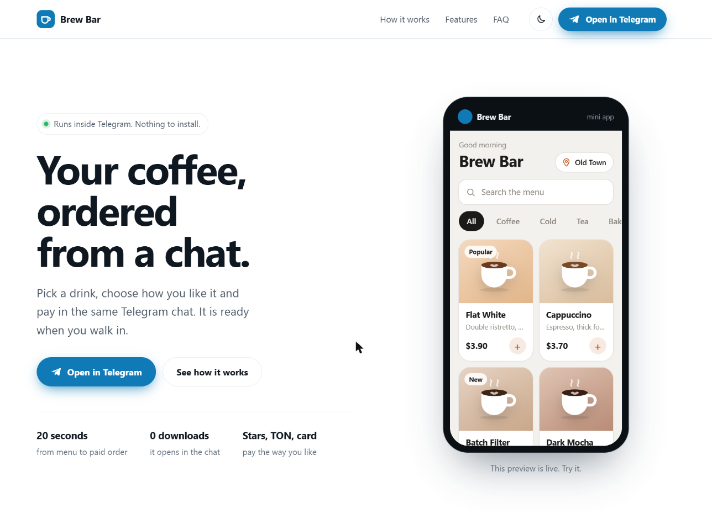

# Landing page template for Telegram Mini Apps

A one-page site for a Mini App or a bot: what it does, how it works, and one button that opens it in Telegram. Plain HTML and CSS, no build step, no framework, no web fonts, no images.

**[Live demo](https://eliezercombi.github.io/miniapp-landing/)** (the phone in the hero runs a real mini app)

- About 21 KB before compression, three files: `index.html`, `styles.css`, `script.js`
- Light and dark themes from one set of CSS variables; follows the system, remembers the visitor's choice, no flash on load
- The hero phone can show your Mini App live in an `<iframe>` or a screenshot
- Text contrast meets WCAG AA in both themes; keyboard focus styles; honours reduced motion
- Works with JavaScript switched off (only the theme button needs it)

## Make it yours in ten minutes

The HTML has five numbered `EDIT` comments. In order:

1. **Title and description** in `<head>`. These are what Telegram, search engines and link previews show.
2. **Logo and name** in the header. The logo is an inline SVG; replace the `<path>` or drop in an ``.
3. **Your Mini App link.** Every link with `class="open"` should point to your app. Search for `your_bot` and replace all of them.
4. **Proof points** under the hero buttons. Three short facts, or delete the list.
5. **The phone.** Put your Mini App's `https` address in the iframe `src`, or use a screenshot: ``.

Then rewrite the steps, features and FAQ. Each is ordinary HTML.

### Link formats

| You have | Link to use |
| --- | --- |
| A Mini App registered in BotFather with a short name | `https://t.me/your_bot/appname` |
| The same, passing a parameter to the app | `https://t.me/your_bot/appname?startapp=promo42` |
| A bot whose main Mini App is set in BotFather | `https://t.me/your_bot?startapp` |
| A bot without a Mini App | `https://t.me/your_bot?start=landing` |

On a computer the link opens Telegram Desktop or Telegram Web. On a phone it opens the Telegram app.

### Colours

Change `--accent` at the top of `styles.css` (once under `:root` for the light theme, once under `[data-theme="dark"]`). Keep two things readable when you do:

- `--accent-ink` is the text on top of the accent colour (button labels). Use white on a dark accent and near-black on a light one.
- `--accent-text` is the accent used as text on the page background (section labels, links). It usually needs to be darker than `--accent` in the light theme and lighter in the dark one.

### If your Mini App refuses to load in the phone

Some hosts send headers that forbid embedding (`X-Frame-Options` or a `frame-ancestors` policy). Either allow your landing page's origin there, or use a screenshot instead.

## Put it online

It is a static folder. GitHub Pages, Cloudflare Pages, Netlify or any web server will do: upload the three files and point your domain at them.

## License

MIT. Use it for your own projects and for client work.

## More

- The mini app in the demo is open source too: [tma-shop](https://github.com/eliezercombi/tma-shop).
- A paid kit adds seven contrast-checked colour presets, a pre-launch page with a countdown, a share card and a launch checklist. Or I adapt the page to your app and put it on your domain. Both are described at [eliezercombi.github.io/kits](https://eliezercombi.github.io/kits/).
